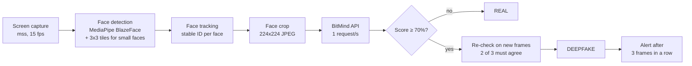

# Real-Time Deepfake Detection System

A Windows desktop app that watches your screen during a video call (Zoom, Teams, Google Meet or any other) and warns you when a face on it looks like a deepfake. It finds every face on the primary screen, checks each one with the [BitMind](https://bitmind.ai) deepfake detection API, marks it **REAL** or **DEEPFAKE** on a live preview, and raises an alert when a deepfake stays on screen.

## Download

**[Download the latest release](https://github.com/chunshen02/FYP-FOR-BCS24020002/releases/latest)** (`DeepfakeDetector-v1.1.1-win64.zip`).

1. Extract the whole zip (right-click → **Extract All**). The exe does not run from inside the zip.
2. Open the extracted `DeepfakeDetector` folder and double-click **DeepfakeDetector.exe**. Keep the `_internal` folder beside it.
3. If Windows SmartScreen shows "Windows protected your PC", click **More info → Run anyway**. The exe is not code-signed.

A Quick Start guide opens on first launch, and the **?** button opens it again. The full manual is [`USER_GUIDE.txt`](USER_GUIDE.txt), also included in the zip.

**Requirements:** Windows 10 (version 2004 or later) or Windows 11, 64-bit; an internet connection; the video call shown on the primary screen.

## Features

- **Live face boxes**: every face is boxed green (REAL) or red (DEEPFAKE) with BitMind's deepfake score; faces still being checked show "Analyzing…".
- **Confidence gauge**: an animated gauge with the most suspicious face's deepfake score, and the threshold marked on it.
- **Alerts**: an alert card, a beep, a desktop notification, a flashing taskbar icon and a full-screen evidence screenshot.
- **Detection Analysis**: the verdict and score for the most suspicious face, with supporting evidence from local image checks.
- **Mini Mode**: a small always-on-top panel with live face thumbnails, so the call stays in view.
- **Detection zone**: drag a rectangle on the preview to check only the call window.
- **Re-check**: ask for a fresh verdict on any face.
- **Settings**: deepfake threshold, and the alert beep, notification and screenshot on or off.
- **Session history**: saved sessions with their alert screenshots, exportable to CSV.

## How it works



- The app captures the primary screen about 15 times a second and finds faces with MediaPipe BlazeFace. It also runs BlazeFace on overlapping 3×3 tiles, so small faces in a gallery view are found.
- Each face is tracked across frames, so it keeps its verdict while it stays on screen instead of being sent to BitMind every frame. Up to 3 faces wait for a verdict at a time.
- A face that looks real on its first check is REAL. A face that looks like a deepfake is checked on up to 3 frames, and is marked DEEPFAKE only if at least 2 agree, so one wrong answer cannot raise an alert.
- The app's own window is excluded from the capture (`SetWindowDisplayAffinity`), so it never checks itself.
- For DEEPFAKE faces, local image checks (frequency spectrum, noise mismatch, left-right asymmetry) add supporting evidence. They are not a separate detector.

## Run from source

Requires Python 3.13 and a BitMind API key ([how to get one](API_CONNECTION_GUIDE.txt)).

```powershell
python -m venv .venv
.venv\Scripts\activate
pip install -r requirements.txt
```

Create a file named `.env` in the project folder:

```
BITMIND_API_KEY=your_key_here
BITMIND_API_KEY_SECONDARY=your_second_key_here   # optional backup key
```

Then start the app:

```powershell
python main.py
```

## Build the exe

```powershell
pip install pyinstaller
pyinstaller deepfake_detector.spec --noconfirm
```

This produces `dist/DeepfakeDetector/` (`DeepfakeDetector.exe` plus its `_internal` folder). `.env` and `runtime/detection/blaze_face_short_range.tflite` must exist before building.

## Evaluation

All tests use [FaceForensics++](https://github.com/ondyari/FaceForensics) (c23) videos.

### Detection accuracy

100 real videos and 500 deepfake videos (100 per manipulation method), classified with the app's own pipeline and confirmation rule at a 70% threshold. Source: [`results/accuracy_summary.txt`](results/accuracy_summary.txt).

| Accuracy | Precision | Recall | F1 | False-positive rate |
|---:|---:|---:|---:|---:|
| 66.8% | 98.1% | 61.4% | 75.5% | 6.0% |

| Method | Deepfakes caught | Accuracy vs. real videos |
|---|---:|---:|
| Deepfakes | 90% | 92.0% |
| FaceSwap | 75% | 84.5% |
| Face2Face | 65% | 79.5% |
| FaceShifter | 45% | 69.5% |
| NeuralTextures | 32% | 63.0% |

When the app flags a face, it is almost always a deepfake (98.1% precision), but it misses more than a third of deepfakes, mostly those from the subtler methods (FaceShifter, NeuralTextures).

### Real-time performance

24 clips played full screen at 2560×1600 through the app's detection pipeline. Source: [`results/performance_summary_20261013_135532.txt`](results/performance_summary_20261013_135532.txt).

| Metric | Measured | Target |
|---|---:|---:|
| Mean FPS | 14.9 | ≥ 10 |
| Mean frame latency (capture + detection + tracking) | 51.1 ms | ≤ 100 ms |
| Mean time from a face appearing to its final verdict | 6.3 s | ≤ 15 s |
| Mean CPU (app process) | 6.2% | ≤ 70% |
| Peak RAM (app process) | 336 MB | ≤ 800 MB |

Most of the time to a verdict is spent waiting for BitMind (mean response 3.8 s per call).

### Screen face pipeline

12 clips shown full screen, captured from the real screen and turned into BitMind-ready face crops (no API calls). Source: [`results/pipeline_summary_20261013_134459.txt`](results/pipeline_summary_20261013_134459.txt).

| Metric | Measured | Target |
|---|---:|---:|
| Face hit rate (clip frames with a face found) | 100% | ≥ 90% |
| False detections (black frames between clips) | 0% | 0% |
| Main-face track continuity | 100% | ≥ 95% |
| Mean frame latency (grab → crops ready) | 62.5 ms | ≤ 100 ms |

### Reproducing the tests

Put FaceForensics++ c23 at the path set by `FF_DATASET_ROOT` in [`config.py`](config.py), then run:

```powershell
python detection_accuracy.py              # accuracy; resumable, needs an API key
python detection_accuracy.py --summary-only   # re-print the summary from the CSV
python realtime_performance.py            # FPS, latency, CPU and RAM; needs an API key
python screen_face_pipeline.py            # screen capture to face crops; no API key needed
```

The same commands are available as VS Code tasks (`Test: …`). Run one test at a time: a test started while another is running exits at once, because they compete for the screen, the CPU and BitMind's rate limit.

## Configuration

All tuneable values live in [`config.py`](config.py). The most important:

| Setting | Default | Meaning |
|---|---|---|
| `FAKE_THRESHOLD` | `0.70` | Score at or above which a face is DEEPFAKE (also in Settings) |
| `CONFIRM_VERDICTS` / `CONFIRM_FAKE_VOTES` | `3` / `2` | A first DEEPFAKE verdict is re-checked; 2 of 3 decide |
| `ALERT_TRIGGER_FRAMES` | `3` | Frames in a row a face must be DEEPFAKE to raise its alert |
| `ALERT_DISMISS_FRAMES` | `8` | Frames with no DEEPFAKE face before the alert clears by itself |
| `DETECTION_TILE_GRID` | `3` | N×N tiles for finding small faces (1 turns tiling off) |
| `MAX_PENDING_FACES` | `3` | Faces waiting for a verdict at once |

The threshold and the alert beep, notification and screenshot can also be changed in the app's Settings, which are kept between launches.

## Project structure

```
main.py                    Entry point
config.py                  All tuneable constants
runtime/
  capture/                 Screen capture, and excluding the app's window from it
  detection/               Face detection, crop preparation, BitMind API, local evidence checks
  threads/                 Detection pipeline and alert logic (background threads)
  gui/                     Main window, live preview, dialogs, alerts, cyberpunk HUD theme
  storage/                 SQLite session history
detection_accuracy.py      Accuracy test
realtime_performance.py    Performance test
screen_face_pipeline.py    Screen capture to face crop test
deepfake_detector.spec     PyInstaller build
results/                   Test results
```

[`FILE_DESCRIPTIONS.txt`](FILE_DESCRIPTIONS.txt) describes every file in detail.

## Privacy and limitations

- Only cropped face images (224×224) are sent to BitMind. Full screen frames never leave the computer.
- Session history (`session_log.db`) and screenshots are stored only on the computer. Screenshots show the whole screen, so they may contain private information.
- Accuracy depends on the BitMind API. Some deepfakes are missed, especially subtle ones, and some real faces may be flagged. An alert is a warning, not proof.
- Results are less reliable for small, blurred, side-on or poorly lit faces.
- Only the primary screen is checked.
- Built and tested on Windows only.

## Documentation

- [`USER_GUIDE.txt`](USER_GUIDE.txt): full user manual
- [`API_CONNECTION_GUIDE.txt`](API_CONNECTION_GUIDE.txt): getting a BitMind API key and how the app uses the API
- [`FILE_DESCRIPTIONS.txt`](FILE_DESCRIPTIONS.txt): what every source file does
